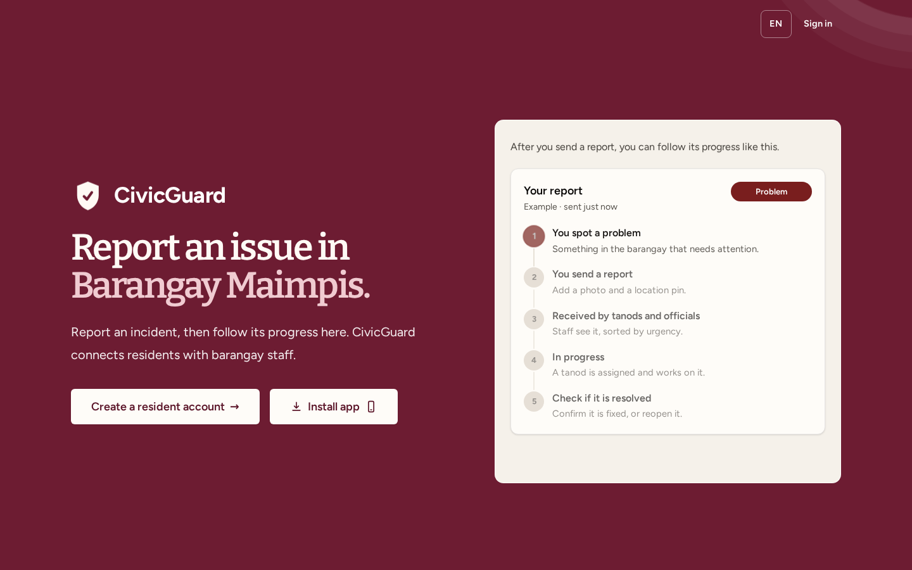
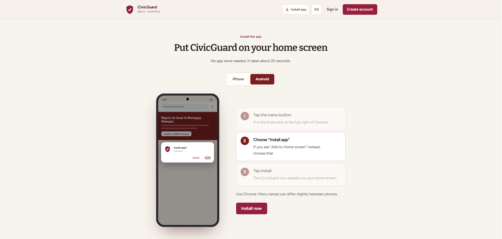
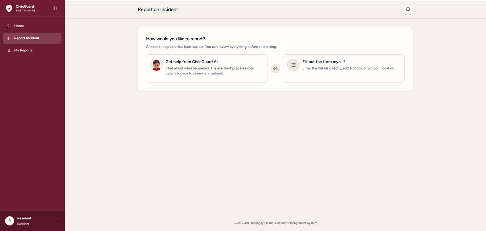

<div align="center">
  
  <h1>CivicGuard</h1>
  <p>A community reporting and follow-up system for Barangay Maimpis, City of San Fernando, Pampanga.</p>
  <p><strong>Capstone project</strong><br><em>CivicGuard: An AI-Integrated Web-Based Incident and Curfew Monitoring System for Barangay Maimpis, City of San Fernando, Pampanga</em></p>
  <p>
    <a href="https://civicguard.wasmer.app">Live Site</a> ·
    <a href="https://civicguard.wasmer.app/privacy">Privacy policy</a> ·
    <a href="https://civicguard.wasmer.app/terms">Terms of use</a>
  </p>
  <p>
    <a href="https://github.com/miconvr/civicguard/actions/workflows/ci.yml"></a>
    <a href="https://github.com/miconvr/civicguard/actions/workflows/uptime.yml"></a>
  </p>
</div>

> **Emergencies:** CivicGuard is not monitored in real time. Call 911 or contact the barangay directly if someone is in immediate danger.

## Features

| Residents | Barangay staff |
| --- | --- |
| File reports with a form or guided chat | Review reports sorted by urgency |
| Add a photo and location details | Assign reports and update their status |
| Follow progress and respond when an issue is marked resolved | Review residence verification requests |
| Request optional residence verification | Record curfew incidents and view analytics |

English and Tagalog, light and dark appearance, mobile layouts and an offline notice. Reporting and account features need an internet connection. AI-assisted reporting helps residents describe incidents; staff review every report and make the decisions.

## Screenshots

<p align="center">
  
</p>
<p align="center">
  
</p>
<p align="center">
  
</p>

## Tech stack

- **App:** Laravel 12, PHP 8.2+, Blade, Alpine.js, Tailwind CSS, Vite
- **Database:** MySQL 8.4
- **AI:** Google Gemini and Groq, with provider fallback (optional)
- **Other:** Laravel Breeze, DomPDF, Figtree and Bitter fonts (SIL Open Font License, files in `public/fonts`)
- **Local environment:** Laravel Sail and Docker
- **Hosting:** Wasmer

## Run locally

Requires Git, Docker, PHP 8.2+, Composer, and Node.js with npm.

```bash
git clone https://github.com/miconvr/civicguard.git
cd civicguard
cp .env.example .env
```

Set a unique, non-empty `DB_PASSWORD` in `.env`, then:

```bash
composer install
./vendor/bin/sail up -d --build
./vendor/bin/sail artisan key:generate
./vendor/bin/sail artisan migrate --seed
npm ci
npm run dev
```

Open [http://localhost](http://localhost). If port 80 is taken, set `APP_PORT=8000` in `.env`.

The seeder creates report categories, not accounts. New registrations are residents. Create the first administrator with:

```bash
./vendor/bin/sail artisan civicguard:create-admin
```

An administrator can then create official and tanod accounts from the staff management page.

**AI (optional):** the app works without it. To enable it, set `GEMINI_API_KEY` and/or `GROQ_API_KEY` in `.env`. Provider order is set by `AI_PROVIDERS` (default `gemini,groq`). Chat messages and report descriptions may be sent to the provider, so review the [privacy policy](https://civicguard.wasmer.app/privacy) before enabling it for real users.

**Password recovery:** no reset emails are sent. Residents are directed to an administrator or official, who sets a temporary password from the **Reset Resident Passwords** page after confirming identity.

## Checks

```bash
./vendor/bin/sail artisan test
npm run build
vendor/bin/pint --test   # needs PHP and Composer on the host
```

GitHub Actions runs tests, the formatter, the asset build, mobile and accessibility checks, and a production `/up` health check every 15 minutes.

## Deployment

Hosted on Wasmer. Settings are in `app.yaml`. Keep `APP_DEBUG=false`, store `APP_KEY`, database credentials and AI keys in the host's secret settings, and never commit secrets. Uploads use a private disk on a persistent `/data` volume. To deploy a clone, create your own Wasmer app, database and volume, and don't point it at CivicGuard's production data. For backup, restore and retention, see [operations and data stewardship](docs/OPERATIONS.md).

## Privacy

Reports, locations and optional photos can contain personal data, and photos may carry embedded location or device metadata. Chat text and report descriptions may be sent to Gemini or Groq when configured. For a software issue, open a GitHub issue with steps to reproduce, and never include passwords, API keys, identity documents or private report details.

## Authors

Developed as a capstone project by Mico Gerard Navarro, Franz Mikey Reyes, Carl Spencer Talon and Adriann Enriquez.

## License

Copyright (c) 2026 Mico Gerard Navarro, Franz Mikey Reyes, Carl Spencer Talon and Adriann Enriquez. All rights reserved. The repository has no open-source license, and no permission is granted to use, copy, modify or distribute the code without written permission from the authors. Bundled fonts keep their own SIL Open Font License.
