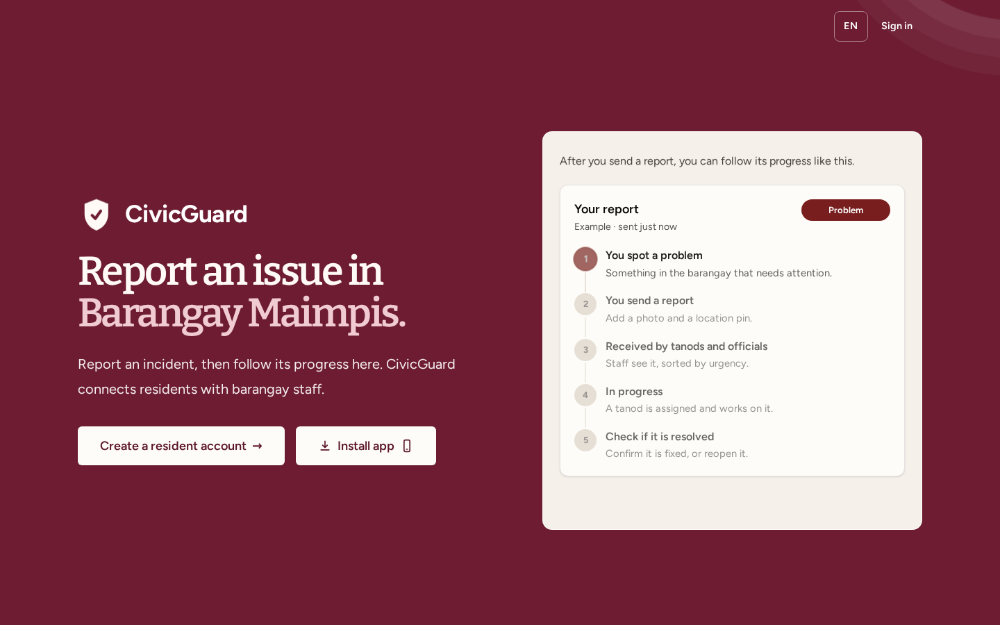
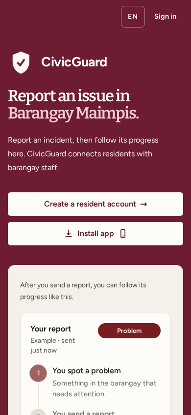

<div align="center">
  
  <h1>CivicGuard</h1>
  <p>Incident reporting and follow-up for Barangay Maimpis, City of San Fernando, Pampanga.</p>
  <p>
    <a href="https://civicguard.wasmer.app">Open the live site</a> ·
    <a href="https://civicguard.wasmer.app/privacy">Privacy policy</a> ·
    <a href="https://civicguard.wasmer.app/terms">Terms of use</a>
  </p>
  <p>
    <a href="https://github.com/miconvr/civicguard/actions/workflows/ci.yml"></a>
    <a href="https://github.com/miconvr/civicguard/actions/workflows/uptime.yml"></a>
  </p>
</div>

Residents can submit an incident report, optionally attach a photo or location pin, and follow staff updates. Barangay staff can review, assign, and resolve reports. The report-writing assistant helps residents describe an incident; staff make decisions and review every report.

> **Emergencies:** CivicGuard is not monitored in real time. Call 911 or contact the barangay directly if someone is in immediate danger.

## Screenshots

<p align="center">
  
</p>
<p align="center">
  
</p>

## Features

| Residents | Barangay staff |
| --- | --- |
| File reports with a form or guided chat | Review reports sorted by urgency |
| Add a photo, location details, or a map pin | Assign reports and update their status |
| Follow progress and respond when an issue is marked resolved | Review residence verification requests |
| Request optional residence verification | Record curfew incidents and view analytics |

The interface supports English and Tagalog, light and dark appearance, mobile layouts, and an offline notice. Reporting and account features require an internet connection.

## Technology

- **Application:** Laravel 12, PHP 8.2+, Blade, Alpine.js, Tailwind CSS, and Vite
- **Database:** MySQL 8.4
- **AI services:** Google Gemini and Groq, with provider fallback
- **Other packages:** Laravel Breeze and DomPDF
- **Local environment:** Laravel Sail and Docker
- **Hosting:** Wasmer

## Run locally

### Requirements

Git, Docker, PHP 8.2 or newer, Composer, and Node.js with npm. Docker runs the Laravel and MySQL containers through Sail.

### Setup

```bash
git clone https://github.com/miconvr/civicguard.git
cd civicguard
cp .env.example .env
```

Set a unique, non-empty `DB_PASSWORD` in `.env`, then install and initialize the app:

```bash
composer install
./vendor/bin/sail up -d --build
./vendor/bin/sail artisan key:generate
./vendor/bin/sail artisan migrate --seed
npm ci
npm run dev
```

Open [http://localhost](http://localhost). If port 80 is already in use, set `APP_PORT=8000` in `.env` and open [http://localhost:8000](http://localhost:8000).

The seeder creates report categories, not user accounts. New registrations are residents. Create the first administrator from a terminal; the command only works while no administrator exists and prompts for the account details without putting the password in shell history:

```bash
./vendor/bin/sail artisan civicguard:create-admin
```

An administrator can create official and tanod accounts from the staff management page.

### AI configuration (optional)

The rest of the app works without AI keys. To enable the assistant and AI suggestions, set one or both of these in `.env`:

```dotenv
GEMINI_API_KEY=
GROQ_API_KEY=
```

The request order is controlled by `AI_PROVIDERS` (default: `gemini,groq`). Chat messages and report descriptions may be sent to the configured AI provider. Review the [privacy policy](https://civicguard.wasmer.app/privacy) before enabling AI for real users.

## Development checks

Run the feature and unit tests inside Sail, and build the production assets with npm:

```bash
./vendor/bin/sail artisan test
npm run build
```

If PHP and Composer are installed on the host, run the formatter check with:

```bash
vendor/bin/pint --test
```

GitHub Actions runs the test suite, formatter check, and asset build on pushes to `main` and pull requests. A separate workflow checks the production `/up` health endpoint every 15 minutes. Enable workflow failure notifications in GitHub settings if you want alerts.

## Production notes

- Keep `APP_DEBUG=false` and store `APP_KEY`, database credentials, and AI keys in the hosting provider’s secret settings. Do not commit secrets.
- The app’s `/up` route is its health endpoint. Wasmer application warnings are written to `stderr`; view them with `wasmer app logs miconvr/civicguard`.
- User uploads use the private `report_photos` disk. Production sets `PHOTO_DISK_ROOT=/data`; keep that volume persistent and outside the public web root. Verification proof images are deleted after staff make a decision.
- If upgrading a deployment that used the old public upload disk, move its `report-photos`, `profile-photos`, and `verification-documents` directories to the configured private disk before removing the old files.
- Run pending Laravel migrations through the deployment process before serving code that depends on the new schema. Back up the database and upload volume before production maintenance.
- The barangay should define retention periods for reports, audit records, and backups according to its records requirements. The application does not automatically purge those records.

## Privacy and safety

Report descriptions, location information, and optional photos can contain personal data. Photo files may include embedded location or device metadata. Chat text and report descriptions may be sent to Gemini or Groq when those services are configured. Do not use CivicGuard to report an emergency.

## Help and project status

For privacy requests, use the contact details in the [privacy policy](https://civicguard.wasmer.app/privacy). For a software issue, open a GitHub issue with steps to reproduce; do not include passwords, API keys, identity documents, or private report details.

CivicGuard was developed as a capstone project by Mico Gerard Navarro, Franz Mikey Reyes, Carl Spencer Talon, and Adriann Enriquez.

**License:** The repository does not currently include an open-source license.
